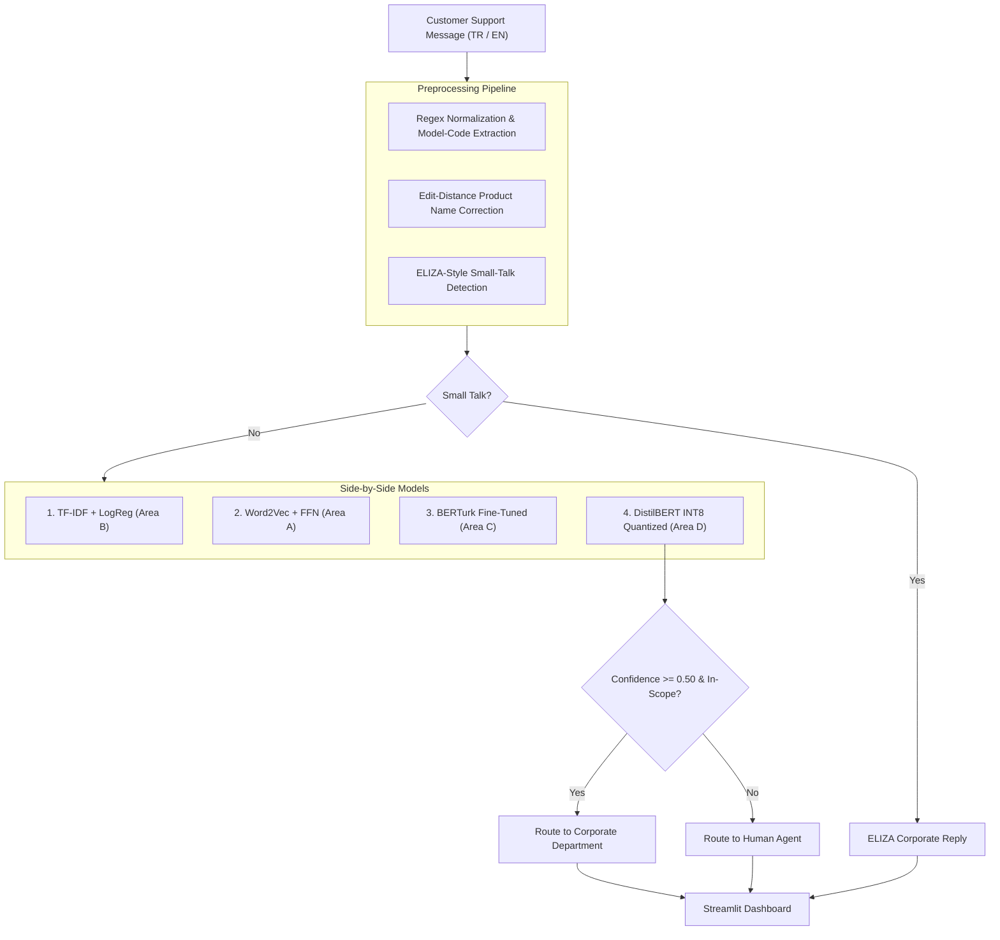

# 🏢 TechnoHome – Intelligent Customer Support Ticket Router

**SWE015 Homework – Use Case 2: Customer Support Ticket Router**

## Overview

TechnoHome is an intelligent customer support ticket routing application designed for a multinational home appliance corporation. It accepts free-text support messages in **Turkish and English**, normalizes noisy text, extracts product model codes, fixes misspelled product names, handles greetings/small talk with ELIZA-style rules, and routes tickets across **8 corporate departments** (or falls back to a **Human Agent** for low-confidence / out-of-scope queries).

The project implements a **four-model ladder** of increasing sophistication, evaluated on the exact same held-out test set:
1. **TF-IDF + Logistic Regression** — Classical NLP baseline (Area B)
2. **Word2Vec + Feedforward Neural Network** — Neural network trained with SGD & backpropagation (Area A)
3. **BERTurk Fine-Tuned** — Transformer sequence classifier (Area C)
4. **DistilBERT (INT8 Quantized)** — Knowledge distillation + dynamic INT8 quantization (Area D, active router in app)

---

## Quick Start

### 1. Clone & Install Dependencies
```bash
git clone <your-repo-url>
cd LLM
pip install -r requirements.txt
```

### 2. Prepare Data & Train Models
*(Skip this step if you downloaded the pre-trained `saved_models/` folder from the external weights link below.)*
```bash
python data/download_data.py          # Download CLINC150 & merge domain examples
python training/train_baseline.py     # Model 1: TF-IDF + LogReg
python training/train_ffn.py          # Model 2: Word2Vec + FFN (SGD)
python training/train_bert.py         # Model 3: BERTurk fine-tuning
python training/train_student.py      # Knowledge distillation (BERT -> DistilBERT)
python training/quantize_model.py     # Model 4: INT8 dynamic quantization
```

### 3. Evaluate All Models
```bash
python evaluation/evaluate_all.py
```

### 4. Run the Application
```bash
streamlit run app.py
```
The dashboard will open in your browser at `http://localhost:8501`.

---

## Architecture



---

## Technique Map (R2)

| Area | Technique | Project Component |
|------|-----------|-------------------|
| **A · Neural Networks & Deep Learning** | Feedforward neural network with Dropout, trained with SGD and backpropagation | `models/feedforward_nn.py` |
| **B · Classical NLP** | Regex normalization, model-code extraction, minimum edit distance, ELIZA rules, TF-IDF + Logistic Regression, Word2Vec embeddings | `preprocessing/` & `models/baseline_tfidf.py` |
| **C · Transformers** | Fine-tuning BERTurk (`dbmdz/bert-base-turkish-cased`) with a classification head | `models/bert_classifier.py` |
| **D · Efficient Models** | Knowledge distillation (BERT → DistilBERT) + PyTorch INT8 dynamic quantization | `models/distill_and_quantize.py` |

---

## Dataset

- **Base Dataset:** [CLINC150 (`clinc/clinc_oos`, `plus` split)](https://huggingface.co/datasets/clinc/clinc_oos) — includes an explicit out-of-scope (`oos`) class.
- **Domain Adaptation:** 90 hand-written bilingual (Turkish & English) corporate appliance support examples in `data/domain_examples.json`.
- **Splits:** 4,040 train / 840 validation / 2,110 test examples across 8 corporate departments (identical splits for all 4 models).

| Department | Description |
|------------|-------------|
| 🔧 Technical Support | Appliance repairs, troubleshooting, error codes |
| 📦 Order & Delivery | Order tracking, shipping, delivery scheduling |
| 💳 Billing & Payments | Invoices, payment issues, refunds |
| 🔄 Returns & Warranty | Returns, warranty claims, product exchanges |
| 📋 Product Information | Specs, compatibility, recommendations |
| 🛠 Installation & Setup | Installation guides, Wi-Fi / setup help |
| 📞 Account Management | Account updates, password resets, preferences |
| 🤖 Human Agent | Out-of-scope or low-confidence fallback |

---

## Results (R3 & R4)

All 4 models were evaluated on the exact same held-out test set (2,110 samples). Latency was averaged over 100 runs on **CPU**.

| Model | Accuracy | OOS Recall | Macro-F1 | Size (MB) | Latency (ms) | Hardware |
|-------|----------|------------|----------|-----------|--------------|----------|
| **TF-IDF + LogReg** (Area B) | 65.02% | 29.50% | 0.7287 | 0.99 MB | 0.39 ms | CPU |
| **Word2Vec + FFN** (Area A) | 61.94% | 29.10% | 0.6890 | 0.43 MB | 0.14 ms | CPU |
| **BERT (BERTurk)** (Area C) | 48.10% | 3.40% | 0.5654 | 2,955.11 MB | 48.41 ms | CPU |
| **DistilBERT (INT8 Quantized)** (Area D) | **76.82%** | **59.70%** | **0.7858** | **395.90 MB** | **13.05 ms** | CPU |

---

## Project Structure

```text
LLM/
├── app.py                        # Streamlit web application
├── config.py                     # Paths, department taxonomy, hyperparameters
├── requirements.txt              # Python dependencies
├── README.md                     # Project documentation
├── LICENSE                       # MIT License
├── .gitignore                    # Excludes large weights, caches, and generated files
├── data/
│   ├── download_data.py          # Downloads CLINC150 and builds dataset splits
│   ├── domain_examples.json      # Hand-written Turkish & English support examples
│   └── product_lexicon.json      # TechnoHome product catalog & misspellings
├── preprocessing/
│   ├── normalizer.py             # Regex normalization & model-code extraction
│   ├── spell_corrector.py        # Edit-distance spelling correction
│   └── small_talk.py             # ELIZA-style small-talk responder
├── models/
│   ├── baseline_tfidf.py         # Model 1: TF-IDF + Logistic Regression
│   ├── feedforward_nn.py         # Model 2: Word2Vec + Feedforward NN
│   ├── bert_classifier.py        # Model 3: BERTurk fine-tuned classifier
│   ├── distill_and_quantize.py   # Model 4: DistilBERT distillation & INT8 quantization
│   └── model_utils.py            # Shared Prediction type, size & latency helpers
├── training/
│   ├── train_baseline.py
│   ├── train_ffn.py
│   ├── train_bert.py
│   ├── train_student.py
│   └── quantize_model.py
├── evaluation/
│   └── evaluate_all.py           # Unified test-set benchmark across all 4 models
└── results/
    ├── results_table.json
    └── classification_reports.json
```

---

## Model Weights

Per R7, large model weights (`saved_models/`) are excluded from Git via `.gitignore`.
- **Download trained weights:** *(Add your Hugging Face Hub or Google Drive link here and extract into `saved_models/`)*, or reproduce them locally using the training commands in Quick Start.

---

## AI Usage Statement (R8)

AI coding assistants (Antigravity / Claude / Gemini) were used to assist with boilerplate code generation, debugging library compatibility issues, and drafting documentation. All code was reviewed and executed locally, and all reported metrics come directly from local evaluation runs.

---

## License

This project is licensed under the MIT License — see the [LICENSE](LICENSE) file for details.
